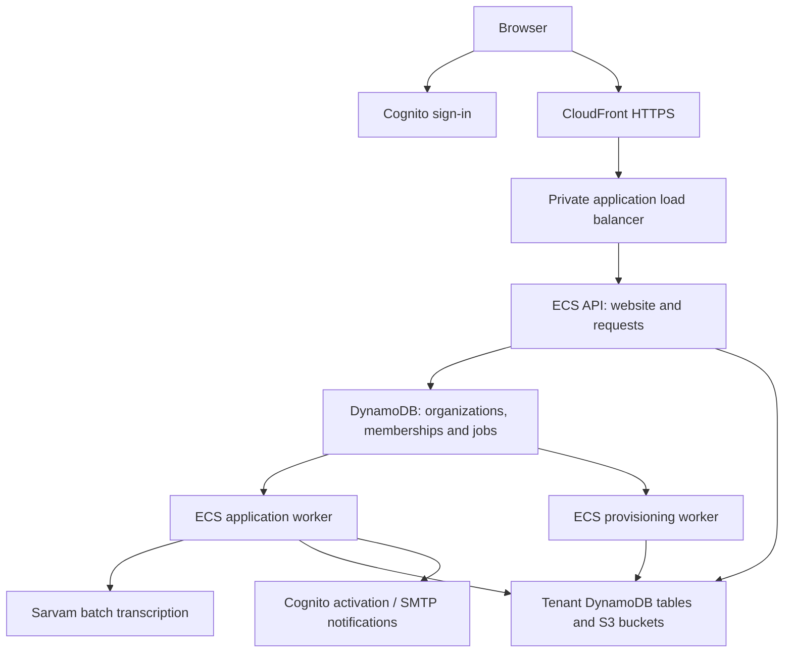

# Running Learning Setu on AWS

Repository runbook, checked 21 October 2026. Commands assume the repository root, AWS profile `jso`, region `ap-south-1`, and stack `learning-setu-staging`. For an existing deployment, start at **Updating an existing deployment**; do not create another network or bootstrap another administrator.

See [monthly transcription estimates](monthly-costs.md) for Sarvam costs and AWS budgeting inputs, and [operations](operations.md) for detailed recovery, retention and offboarding procedures.

## What runs in AWS



| Service | Responsibility | Default capacity |
|---|---|---|
| API | Serves the frontend, checks identity and roles, manages schools/students and queues jobs | One task, 0.25 vCPU, 0.5 GB |
| Application worker | Transcription, scoring, activation/invitation jobs, student deletion and retention | One task, 0.5 vCPU, 1 GB |
| Provisioning worker | Organization resource creation and offboarding | One task, 0.5 vCPU, 1 GB |

All three use the same image, with different commands/modes and IAM permissions. The worker split keeps slow jobs outside web requests and keeps infrastructure permissions separate. Jobs are persisted in DynamoDB with leases/retries; this implementation does not use SQS. Sarvam runs as an external hosted API, not as a model on Fargate or SageMaker.

The template also creates Cognito company/tenant pools, a control table, document bucket, CloudWatch logs and a retained Sarvam secret. Organization approval dynamically creates dedicated tenant tables/buckets outside CloudFormation. The optional network template creates a VPC, two public and two private subnets, and one NAT gateway. Custom-domain mode uses a public HTTPS ALB instead of CloudFront and the private ALB.

## First deployment

### 1. Prerequisites

Install AWS CLI v2, Docker with Linux/amd64 image builds, Bash and Python 3. The deployer needs permissions for CloudFormation, IAM, ECR, ECS, networking/load balancing, CloudFront VPC origins, Cognito, DynamoDB, S3, CloudWatch Logs and Secrets Manager. Authenticate the `jso` profile using your account's normal credential process; verify the destination:

```sh
aws --profile jso --region ap-south-1 sts get-caller-identity
```

Use separate accounts or isolated resource prefixes for staging and production. The managed secret name `learning-setu/sarvam` can have only one owning stack per account/region. For another stack, supply an existing **raw-key** secret ARN through `SarvamSecretArn`; do not point that override at the managed JSON secret, because the override currently expects raw text.

### 2. Create or select networking

Skip creation when using an existing suitable VPC. For the supplied staging network:

```sh
aws --profile jso --region ap-south-1 cloudformation deploy \
  --stack-name learning-setu-staging-network \
  --template-file infrastructure/network.yml \
  --parameter-overrides Prefix=setu-staging
aws --profile jso --region ap-south-1 cloudformation describe-stacks \
  --stack-name learning-setu-staging-network \
  --query 'Stacks[0].Outputs' --output table
aws --profile jso --region ap-south-1 ec2 describe-managed-prefix-lists \
  --filters Name=prefix-list-name,Values=com.amazonaws.global.cloudfront.origin-facing \
  --query 'PrefixLists[0].PrefixListId' --output text
```

Record the VPC, public/private subnet IDs and CloudFront prefix-list ID. Private tasks need outbound connectivity to pull images, reach AWS services and contact Sarvam and its signed storage endpoints. The supplied single-NAT network is a staging configuration; it is not a complete multi-zone availability design.

### 3. Prepare parameters and deploy with integrations disabled

Create the ignored `scripts/aws/parameters.local.json`, replacing every `REPLACE` value below. This example intentionally does not require SMTP credentials on first launch:

```json
{
  "AccessMode": "cloudfront",
  "CloudFrontPrefixListId": "pl-REPLACE",
  "VpcId": "vpc-REPLACE",
  "PublicSubnets": "subnet-REPLACE,subnet-REPLACE",
  "PrivateSubnets": "subnet-REPLACE,subnet-REPLACE",
  "DisableIntegrations": "true",
  "EnableActivationEmails": "true",
  "SarvamSecretArn": "",
  "SarvamModel": "saaras:v3"
}
```

Do not put actual passwords or API keys in this file. Leave `AppOrigin` and `CertificateArn` absent in CloudFront mode.

```sh
AWS_PROFILE=jso AWS_REGION=ap-south-1 \
  ./scripts/aws/deploy.sh staging scripts/aws/parameters.local.json
```

The script validates parameters, creates the ECR repository if needed, builds/pushes an immutable image tag, deploys the application stack and prints outputs. Record the image tag/digest and `ApplicationUrl`. Visit that HTTPS URL and `/api/health`. CloudFormation creates `learning-setu/sarvam` with `{"SARVAM_API_KEY":"dummy"}`.

### 4. Bootstrap the company administrator once

In the company Cognito pool identified by the `CompanyPoolId` output, create the intended administrator using Cognito's invitation flow. Verify their email, complete the initial password change, and enroll the required software-token MFA. Use the immutable Cognito **sub** attribute, not the email or username, for the allowlist entry.

In the control table identified by `ControlTable`, an authorized operator must create a new item with `pk` = `COMPANY`, `sk` = that exact sub, `active` = Boolean `true`, and `rev` = Number `1`. Record who approved the bootstrap; do not overwrite an existing entry. The company-pool identity and this active allowlist entry are both required. There is no public bootstrap endpoint, and local seed accounts must not be installed in AWS.

Sign in through **Company administrator sign-in** and confirm Company review is accessible. Use [operations](operations.md) for the activation/claim behavior of public applications.

### 5. Configure Sarvam and SMTP, then enable assessments

1. Obtain a Sarvam API key with access to `saaras:v3` batch transcription and fund the account for the intended usage.
2. In Secrets Manager in `ap-south-1`, create or select a secret containing the working Sarvam API key as **raw plaintext** and record its ARN. The current template requires a non-empty `SarvamSecretArn` when integrations are enabled; this explicit override expects raw text, not the managed JSON secret.
3. Create an SMTP secret containing JSON fields `username` and `password`. Configure a verified sender and an SMTP server that supports TLS on port 465. This application does not create an SMTP provider/account or SES sender setup for you.
4. Add `SmtpHost`, `SmtpSecretArn` and `MailFrom` to the local parameter file, and change `DisableIntegrations` to `false`. Set `SarvamSecretArn` to the raw plaintext secret ARN from step 2. Do not point this override directly at `learning-setu/sarvam`, whose managed value is JSON.
5. Redeploy with the command above and a new image tag. This starts tasks that load the configured secrets.

The deployment switch supplies the default for organizations without an explicit integration setting. Company administrators can override it per organization using **Organization integrations**. Updating a credential alone does not change organization permission. `EnableActivationEmails=true` independently enables Cognito activation invitations even while the global switch is disabled. Inspect queued jobs before enabling integrations: eligible pending work can resume.

### 6. Verify the user workflow

Submit a synthetic organization application, approve it in Company review and wait for ACTIVE. Confirm administrator activation/sign-in, create a school with name/block/district/state, and create a team member with ASSESSOR role. As the teacher, create a synthetic student with the school dropdown and valid guardian declarations. As the teacher, select that existing student and start a short reading assessment. Verify microphone access, upload, processing, result history and authorized playback. This final test contacts Sarvam and consumes credits; local mock results do not verify the paid provider.

Organization sign-in prompts for username/email and password for either administrators or team members. The school dropdown contains only schools from the selected organization. A VIEWER cannot create students or assessments.

## Updating an existing deployment

Keep a reviewed copy of the current parameter values. Do not replace them with an example file: omitted flags/defaults may change behavior. Update code, run the relevant checks, and deploy with a unique image tag:

```sh
AWS_PROFILE=jso AWS_REGION=ap-south-1 IMAGE_TAG=release-YYYYMMDD-N \
  ./scripts/aws/deploy.sh staging scripts/aws/parameters.local.json
```

Use a new tag on every invocation because ECR tags are immutable. Preserve the previous image URI and configuration for rollback. To roll back application code, redeploy the appropriate compatible CloudFormation template/parameters with the previous image URI; the normal script builds a new image and does not select an existing image for you. Assess schema compatibility first.

List actual resource names instead of relying on generated ECS names:

```sh
aws --profile jso --region ap-south-1 cloudformation list-stack-resources \
  --stack-name learning-setu-staging \
  --query 'StackResourceSummaries[?ResourceType==`AWS::ECS::Service` || ResourceType==`AWS::ECS::Cluster` || ResourceType==`AWS::Logs::LogGroup`].[LogicalResourceId,PhysicalResourceId]' \
  --output table
```

In ECS, check all three services: running count matches desired count, deployments finish, and tasks are not repeatedly failing. Check CloudFormation for `UPDATE_COMPLETE` and the application's `/api/health` response for `{"status":"ok"}`. Inspect API/Application/Provisioning log streams in the stack's CloudWatch log group.

## Reloading a changed secret

ECS injects secrets when tasks start; editing a secret does not update a running container. After rotating the Sarvam key, replace the resource placeholders with the cluster and **ApplicationService** identifiers from the listing above:

```sh
aws --profile jso --region ap-south-1 ecs update-service \
  --cluster YOUR_CLUSTER --service YOUR_APPLICATION_SERVICE \
  --force-new-deployment
aws --profile jso --region ap-south-1 ecs wait services-stable \
  --cluster YOUR_CLUSTER --services YOUR_APPLICATION_SERVICE
```

This restarts the worker; it does not change organization integration permissions. The managed secret is retained on stack deletion. Ordinary updates that leave its initial `SecretString` template property unchanged do not reset an edited value. Do not modify that property to rotate a real key. See [AWS secret refresh behavior](https://docs.aws.amazon.com/AmazonECS/latest/developerguide/specifying-sensitive-data.html).

## Daily operations and troubleshooting

| Symptom | Check |
|---|---|
| Recording button absent | Identity must be ASSESSOR; select an existing student with current guardian authorization |
| Submit assessment unavailable | Check Organization integrations, Assessment processing, and worker configuration status; local recording/playback remains available |
| School dropdown empty | Admin must add a school to the selected organization |
| Worker cannot start | ECS stopped-task reason; secret existence/JSON field; execution-role permission; network access |
| Sarvam credential not configured | Placeholder/blank key or worker not restarted after editing |
| Sarvam HTTP error | Account credits, key/model access, provider status and outbound access; never print the key to logs |
| English speech appears in Hindi script | Check the passage language and deployed image; English must use `en-IN` with `transcribe`, as described below |
| Assessment stays queued | Application service running, integration flag, job retries/lease and provider state |
| Organization provisioning fails | Provisioning logs, IAM, table/bucket quotas and ownership tags |
| SMTP fails | TLS/465 reachability, sender authorization, secret fields and credentials |
| API returns company access denied | Correct company pool, MFA and active COMPANY/sub allowlist entry |

Monitor service health, failed/old jobs, Sarvam balance, AWS spending, storage growth and backups. CloudWatch logs are configured, but the template does not supply a complete alarm/on-call system or autoscaling policy. Current desired counts are fixed at one per service. Do not assume idle workers, NAT or the ALB are free.

For backup/PITR restoration, provider-job reconciliation, tenant offboarding and domain migration, follow [operations](operations.md). Deleting CloudFormation stacks is not a complete data cleanup: retained resources and dynamically created tenant resources can remain and continue to incur charges. Stopping ECS tasks also leaves networking, storage and other billable resources running.

### English speech appears in Hindi script

The worker takes the language from the saved passage, independently of the interface language. `Sarvam.Create` normalizes English/Hindi names and codes and rejects missing or unsupported values. English jobs use `language_code: en-IN` with `mode: transcribe`; Hindi jobs use `language_code: hi-IN` with `mode: verbatim`.

On 25 October 2026, a correctly labeled English recording returned English words in Devanagari for its opening sentences in Saaras v3 verbatim mode. Replaying the same audio with standard transcription returned English script. The fix was deployed as `20261025-english-transcribe-1`. Standard transcription may normalize numbers and punctuation; it is not translation and does not replace speech with the expected passage.

For a recurrence, identify the assessment and creation time, check its saved passage language and provider job ID, and compare the stored transcript with the displayed text. Confirm that the application worker runs the expected release. Do not print API keys or signed storage URLs in logs. Verify a new English and Hindi recording after rollout: existing completed results and scores are unchanged, and already-created provider jobs retain their original mode. Request-body unit tests verify the language/mode pair but cannot guarantee provider recognition quality.

## Per-organization assessment processing

Company administrators can open **Company review → organization details → Assessment processing**, enter a reason, and enable or disable processing for that organization. Active and suspended organizations support this setting; enabling does not reactivate a suspended organization. Existing organizations without an explicit setting retain their previous access.

`POST /api/company/organizations/{id}/assessment-processing` accepts `{"enabled":false,"reason":"School holiday"}`. Only company administrators may change it. Changes and their previous values are recorded in the organization audit history. `GET /api/tenant/assessment-settings` returns the organization setting, platform availability, and effective processing availability for the current tenant.

Disabling blocks assessment creation, upload completion and retries, and pauses queued assessment jobs without consuming attempts. Re-enabling resumes queued work. Already-running provider requests may finish; this is not a provider cancellation feature. Existing results and local recording/playback remain available.

The assessment-only setting is separate from **Organization integrations**. A company administrator can set `IntegrationsEnabled` to true or false for one organization through `POST /api/company/organizations/{id}/integrations`, with a Boolean `enabled` and required `reason`. This explicit setting overrides the `DisableIntegrations` deployment default for assessment submissions and general email invitations. It does not change other organizations, Cognito sign-in invitations or credentials.

The application worker publishes nonsecret credential-presence status every 30 seconds; it expires after five minutes. API submission and invitation availability use this status, and the worker checks its own credentials before taking queued work. Configuration status does not verify provider credit or delivery. With explicit organization control, keep `DisableIntegrations=true`, configure the managed Sarvam JSON key and restart the worker; SMTP is optional for assessments. If SMTP is required, configure its hostname, sender and secret. The template loads SMTP secrets when a secret ARN is configured, independently of the deployment default. A missing/placeholder credential pauses the corresponding work without consuming attempts.

For the complete company and school staff workflow, see the [onboarding and operations guide](onboarding.md).

## Temporary audio storage

The application runs as UID/GID `65532:65532` with a read-only root filesystem. Audio validation uses the writable `/tmp` task volume. The runtime image must declare `VOLUME ["/tmp"]` and set its mode to `1777`; Fargate otherwise creates the empty mount as root-owned `0755`, preventing the worker from preparing audio. `TEMP_STORAGE_UNAVAILABLE` identifies this failure without logging audio, credentials or student details. Deploy the corrected image before retrying preserved failed uploads.

Sarvam can return presigned Azure, Google or S3 storage URLs. The adapter accepts HTTPS object-storage endpoints in these supported domains and never forwards the Sarvam API key to them. `PROVIDER_STORAGE_UNSUPPORTED` indicates an unsupported storage URL. An assessment stopped at `CREATED` can retry upload to its existing provider job after a client compatibility fix; do not create another provider job or reset an ambiguous `CREATING` state. Assessment failure retries count consecutive failures separately from successful stage transitions and status polls.
